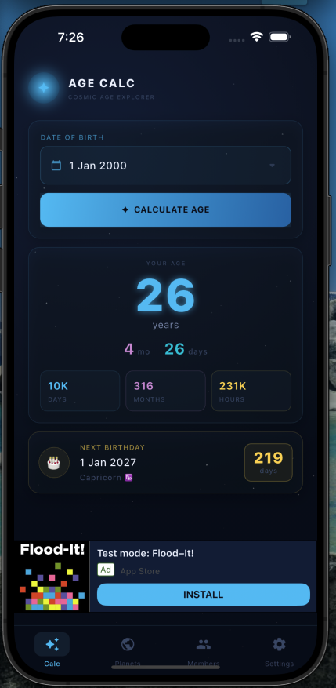
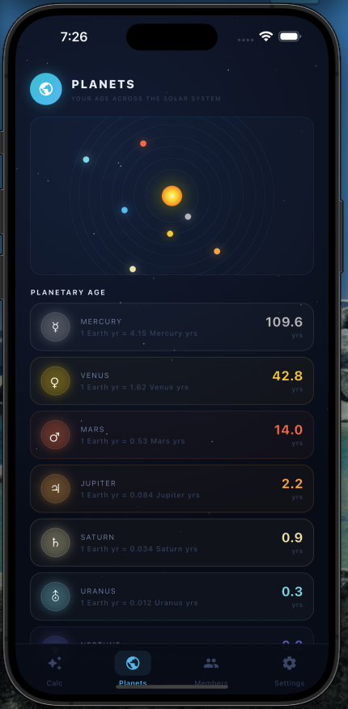
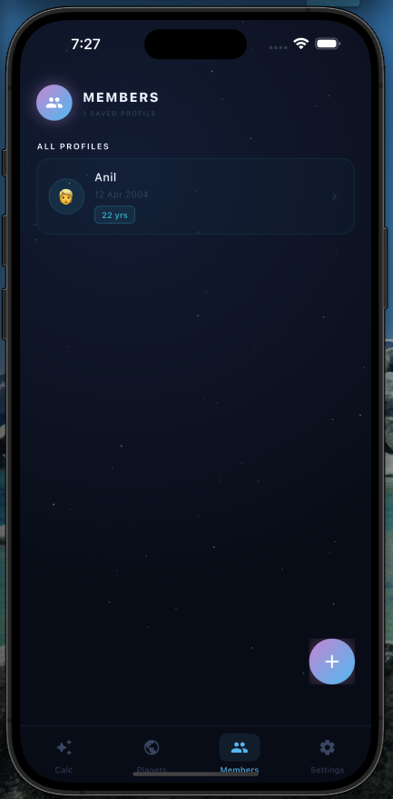
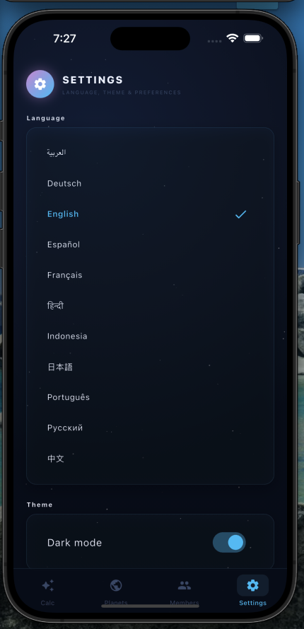

# Age Calculator 🌌

A cosmic-themed Flutter mobile application for age-related utilities, with Android and iOS projects, localization resources, customizable themes, and Google Mobile Ads integration.

> **Repository note:** This README describes the files currently tracked on `main`. The feature folders under `lib/modules/` contain empty controller, model, and screen placeholders. Screenshots illustrate the intended experience; they are not proof that every feature is implemented in the current checkout.

## Screenshots

<p align="center">
  
  
  
  
</p>

## Project layout

```text
age_calculator/
├── android/                   # Android host project and Gradle configuration
├── ios/                       # iOS Runner and Xcode configuration
├── assets/
│   ├── images/                # App icon
│   └── screenshots/           # README screenshots
├── lib/
│   ├── main.dart              # Flutter entry point
│   ├── app.dart               # Application configuration
│   ├── config/
│   │   ├── routes/            # App router and route names
│   │   └── services/          # Ads service
│   ├── core/
│   │   ├── const.dart         # Shared constants
│   │   ├── theme/             # Theme and theme provider
│   │   ├── utils/             # Locale provider
│   │   └── widgets/           # Ad-related widgets
│   ├── l10n/                  # ARB translations and generated Dart localizations
│   └── modules/
│       ├── age/               # Empty feature placeholders
│       ├── birthday/          # Empty feature placeholders
│       ├── planets/           # Empty feature placeholders
│       ├── settings/          # Empty feature placeholders
│       └── view.dart
├── l10n.yaml                  # Localization generation settings
├── analysis_options.yaml      # Dart analyzer settings
├── pubspec.yaml               # Flutter dependencies and assets
└── README.md
```

## Technology

- **Flutter / Dart** — cross-platform mobile development
- **Provider** — state management dependency
- **Shared Preferences** — local storage dependency
- **Intl / Flutter Localizations** — internationalization
- **Google Mobile Ads** — advertising integration
- **Freezed / JSON Serializable** — model and serialization tooling
- **Animations** — Flutter transition utilities

Dependencies are declared in [pubspec.yaml](pubspec.yaml). A dependency's presence does not necessarily mean its corresponding feature is fully implemented.

## Localization

Translation resources are included for Arabic, German, English, Spanish, French, Hindi, Indonesian, Japanese, Portuguese, Russian, and Chinese. Localization generation is configured through [l10n.yaml](l10n.yaml) and Flutter's `generate: true` setting.

## Getting started

### Requirements

- Flutter SDK with a compatible Dart SDK (the project declares Dart `>=3.3.0 <4.0.0`)
- Android Studio or another Android development environment for Android builds
- macOS with Xcode for iOS builds

### Run locally

```bash
git clone https://github.com/satishvishwakarma24/age_calculator.git
cd age_calculator
flutter pub get
flutter run
```

### Useful development commands

```bash
flutter analyze
flutter test
flutter gen-l10n
dart run build_runner build --delete-conflicting-outputs
```

`flutter test` requires tests to be present; the tracked tree currently has no top-level `test/` directory.

## Assets and app configuration

- App icon: `assets/images/icon.png`
- Screenshot gallery: `assets/screenshots/`
- Native splash and launcher icon settings: `pubspec.yaml`
- Android configuration: `android/`
- iOS configuration: `ios/`

For release builds, configure your own signing credentials and verify platform-specific ad settings. Do not commit private signing keys or secrets.

## Development status

The repository currently includes the application entry points, routing files, theme and locale providers, advertising service/widgets, platform projects, and translation resources. The age, birthday, planets, and settings feature modules currently contain zero-byte placeholders. Their implementations should be reviewed or completed before treating the project as feature-complete.

## License

No license file is currently tracked. Add a `LICENSE` file if you intend to grant reuse permissions.
